# RAG Benchmark Report — 20261018-110135-e7cf3510

## Summary

Experiment **20261018-110135-e7cf3510** on dataset `offline_fixture` (fingerprint `b837e5b3773ba9c0`). Primary metric: **f1**. Best architecture: **hybrid+rerank+adaptive-k** (f1=0.806). Pareto-optimal: bm25, parent-child. Knee point (best quality gain per ms on the frontier): **parent-child**. Router significantly beats best fixed architecture: **False**.

## 1. Architecture leaderboard (held-out test split)

Mean with 95% bootstrap CI; `n` = queries; `*_n` = queries where the metric is defined.

**Leaderboard**

| arch | n | f1 | em | ndcg@10 | mrr | map | recall@10 | faithfulness | lat_mean_ms | lat_p50_ms | lat_p95_ms | lat_p99_ms | cost_per_query_usd | tokens_per_query | error_rate | abstain_precision | abstain_recall | abstain_f1 | false_abstain_rate | answered_unanswerable_rate | ece | on_pareto_front | abstain_threshold |
|---|---|---|---|---|---|---|---|---|---|---|---|---|---|---|---|---|---|---|---|---|---|---|---|
| bm25 | 72 | 0.792 | 0.792 | 0.942 | 0.991 | 0.926 | 0.930 | 1.000 | 1.325 | 1.241 | 1.877 | 2.063 | 0.000 | 469.264 | 0.000 | 0.500 | 0.933 | 0.651 | 0.246 | 0.067 | 0.072 | True | 0.650 |
| vector-tfidf | 72 | 0.792 | 0.792 | 0.934 | 0.974 | 0.918 | 0.930 | 1.000 | 1.836 | 1.762 | 2.399 | 2.509 | 0.000 | 485.583 | 0.000 | 0.500 | 0.933 | 0.651 | 0.246 | 0.067 | 0.094 | False | 0.650 |
| dense-lsa | 72 | 0.792 | 0.792 | 0.935 | 0.971 | 0.919 | 0.939 | 1.000 | 1.987 | 1.844 | 2.706 | 3.041 | 0.000 | 502.014 | 0.000 | 0.500 | 0.933 | 0.651 | 0.246 | 0.067 | 0.095 | False | 0.650 |
| hybrid-rrf | 72 | 0.792 | 0.792 | 0.942 | 0.991 | 0.929 | 0.930 | 1.000 | 2.761 | 2.364 | 4.136 | 5.934 | 0.000 | 476.972 | 0.000 | 0.500 | 0.933 | 0.651 | 0.246 | 0.067 | 0.072 | False | 0.650 |
| hybrid-weighted | 72 | 0.792 | 0.792 | 0.944 | 0.982 | 0.925 | 0.947 | 1.000 | 2.412 | 2.177 | 3.652 | 5.454 | 0.000 | 480.778 | 0.000 | 0.500 | 0.933 | 0.651 | 0.246 | 0.067 | 0.083 | False | 0.650 |
| hybrid+rerank | 72 | 0.806 | 0.806 | 0.887 | 0.921 | 0.854 | 0.930 | 1.000 | 3.143 | 2.993 | 4.304 | 4.687 | 0.000 | 475.319 | 0.000 | 0.517 | 1.000 | 0.682 | 0.246 | 0.000 | 0.087 | False | 0.650 |
| bm25+rerank | 72 | 0.806 | 0.806 | 0.887 | 0.921 | 0.852 | 0.930 | 1.000 | 2.362 | 2.147 | 3.262 | 4.130 | 0.000 | 468.264 | 0.000 | 0.517 | 1.000 | 0.682 | 0.246 | 0.000 | 0.087 | False | 0.650 |
| parent-child | 72 | 0.806 | 0.806 | 0.931 | 0.974 | 0.913 | 0.930 | 1.000 | 1.765 | 1.691 | 2.344 | 2.660 | 0.000 | 508.319 | 0.000 | 0.517 | 1.000 | 0.682 | 0.246 | 0.000 | 0.097 | True | 0.650 |
| query-fusion | 72 | 0.792 | 0.792 | 0.942 | 0.991 | 0.926 | 0.930 | 1.000 | 4.673 | 1.744 | 19.326 | 56.433 | 0.000 | 468.639 | 0.000 | 0.500 | 0.933 | 0.651 | 0.246 | 0.067 | 0.072 | False | 0.650 |
| multihop-hybrid | 72 | 0.778 | 0.778 | 0.919 | 0.911 | 0.882 | 1.000 | 1.000 | 5.461 | 5.251 | 6.304 | 6.810 | 0.000 | 479.097 | 0.000 | 0.481 | 0.867 | 0.619 | 0.246 | 0.133 | 0.058 | False | 0.650 |
| full-stack | 72 | 0.778 | 0.778 | 0.919 | 0.911 | 0.882 | 1.000 | 1.000 | 6.236 | 5.379 | 9.630 | 9.943 | 0.000 | 479.097 | 0.000 | 0.481 | 0.867 | 0.619 | 0.246 | 0.133 | 0.058 | False | 0.650 |
| hybrid+rerank+adaptive-k | 72 | 0.806 | 0.806 | 0.887 | 0.921 | 0.854 | 0.930 | 1.000 | 3.030 | 2.817 | 4.350 | 4.744 | 0.000 | 311.639 | 0.000 | 0.517 | 1.000 | 0.682 | 0.246 | 0.000 | 0.087 | False | 0.650 |

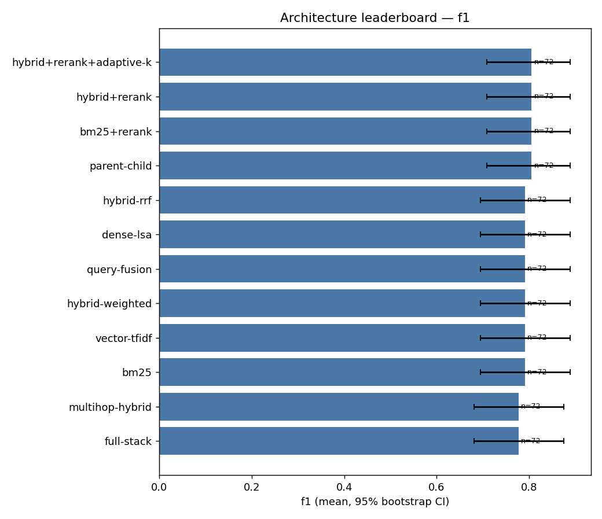

## 2. Quality vs latency (Pareto frontier)

An architecture is Pareto-optimal if no other is both better and faster.

**Quality-first ranking (0.7/0.2/0.1)**

| arch | utility | f1 | lat_p50_ms |
|---|---|---|---|
| parent-child | 0.878 | 0.806 | 1.691 |
| bm25+rerank | 0.856 | 0.806 | 2.147 |
| hybrid+rerank+adaptive-k | 0.824 | 0.806 | 2.817 |
| hybrid+rerank | 0.815 | 0.806 | 2.993 |
| bm25 | 0.550 | 0.792 | 1.241 |
| query-fusion | 0.526 | 0.792 | 1.744 |
| vector-tfidf | 0.525 | 0.792 | 1.762 |
| dense-lsa | 0.521 | 0.792 | 1.844 |
| hybrid-weighted | 0.505 | 0.792 | 2.177 |
| hybrid-rrf | 0.496 | 0.792 | 2.364 |
| multihop-hybrid | 0.006 | 0.778 | 5.251 |
| full-stack | 0.000 | 0.778 | 5.379 |

**Speed-first ranking (0.2/0.7/0.1)**

| arch | utility | f1 | lat_p50_ms |
|---|---|---|---|
| parent-child | 0.824 | 0.806 | 1.691 |
| bm25 | 0.800 | 0.792 | 1.241 |
| bm25+rerank | 0.747 | 0.806 | 2.147 |
| query-fusion | 0.715 | 0.792 | 1.744 |
| vector-tfidf | 0.712 | 0.792 | 1.762 |
| dense-lsa | 0.698 | 0.792 | 1.844 |
| hybrid-weighted | 0.642 | 0.792 | 2.177 |
| hybrid+rerank+adaptive-k | 0.633 | 0.806 | 2.817 |
| hybrid-rrf | 0.610 | 0.792 | 2.364 |
| hybrid+rerank | 0.604 | 0.806 | 2.993 |
| multihop-hybrid | 0.022 | 0.778 | 5.251 |
| full-stack | 0.000 | 0.778 | 5.379 |

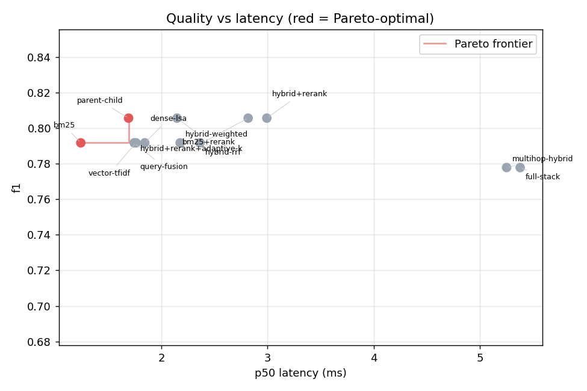

## 3. Performance by query type


**Primary metric by query type**

| arch | factual | keyword | multihop | paraphrase | unanswerable |
|---|---|---|---|---|---|
| bm25 | 1.000 | 1.000 | 0.000 | 0.000 | 0.933 |
| bm25+rerank | 1.000 | 1.000 | 0.000 | 0.000 | 1.000 |
| dense-lsa | 1.000 | 1.000 | 0.000 | 0.000 | 0.933 |
| full-stack | 1.000 | 1.000 | 0.000 | 0.000 | 0.867 |
| hybrid+rerank | 1.000 | 1.000 | 0.000 | 0.000 | 1.000 |
| hybrid+rerank+adaptive-k | 1.000 | 1.000 | 0.000 | 0.000 | 1.000 |
| hybrid-rrf | 1.000 | 1.000 | 0.000 | 0.000 | 0.933 |
| hybrid-weighted | 1.000 | 1.000 | 0.000 | 0.000 | 0.933 |
| multihop-hybrid | 1.000 | 1.000 | 0.000 | 0.000 | 0.867 |
| parent-child | 1.000 | 1.000 | 0.000 | 0.000 | 1.000 |
| query-fusion | 1.000 | 1.000 | 0.000 | 0.000 | 0.933 |
| vector-tfidf | 1.000 | 1.000 | 0.000 | 0.000 | 0.933 |

## 4. Paired significance vs baselines

Paired bootstrap CI of the per-query difference, sign-flip permutation p (BH-adjusted), Cohen's dz and Cliff's δ.

**Paired comparisons**

| metric | arch | baseline | n_pairs | mean_diff | ci_lo | ci_hi | p_adj_bh | cohens_dz | effect | cliffs_delta | significant |
|---|---|---|---|---|---|---|---|---|---|---|---|
| f1 | bm25 | vector-tfidf | 72 | 0.000 | 0.000 | 0.000 | 1.000 | 0.000 | negligible | 0.000 | False |
| f1 | bm25+rerank | vector-tfidf | 72 | 0.014 | 0.000 | 0.042 | 1.000 | 0.118 | negligible | 0.014 | False |
| f1 | dense-lsa | vector-tfidf | 72 | 0.000 | 0.000 | 0.000 | 1.000 | 0.000 | negligible | 0.000 | False |
| f1 | full-stack | vector-tfidf | 72 | -0.014 | -0.056 | 0.028 | 1.000 | -0.068 | negligible | -0.014 | False |
| f1 | hybrid+rerank | vector-tfidf | 72 | 0.014 | 0.000 | 0.042 | 1.000 | 0.118 | negligible | 0.014 | False |
| f1 | hybrid+rerank+adaptive-k | vector-tfidf | 72 | 0.014 | 0.000 | 0.042 | 1.000 | 0.118 | negligible | 0.014 | False |
| f1 | hybrid-rrf | vector-tfidf | 72 | 0.000 | 0.000 | 0.000 | 1.000 | 0.000 | negligible | 0.000 | False |
| f1 | hybrid-weighted | vector-tfidf | 72 | 0.000 | 0.000 | 0.000 | 1.000 | 0.000 | negligible | 0.000 | False |
| f1 | multihop-hybrid | vector-tfidf | 72 | -0.014 | -0.056 | 0.028 | 1.000 | -0.068 | negligible | -0.014 | False |
| f1 | parent-child | vector-tfidf | 72 | 0.014 | 0.000 | 0.042 | 1.000 | 0.118 | negligible | 0.014 | False |
| f1 | query-fusion | vector-tfidf | 72 | 0.000 | 0.000 | 0.000 | 1.000 | 0.000 | negligible | 0.000 | False |
| ndcg@10 | bm25 | vector-tfidf | 57 | 0.008 | 0.000 | 0.020 | 0.769 | 0.189 | negligible | 0.005 | False |
| ndcg@10 | bm25+rerank | vector-tfidf | 57 | -0.047 | -0.089 | -0.008 | 0.100 | -0.290 | small | -0.122 | False |
| ndcg@10 | dense-lsa | vector-tfidf | 57 | 0.002 | -0.004 | 0.009 | 1.000 | 0.066 | negligible | 0.001 | False |
| ndcg@10 | full-stack | vector-tfidf | 57 | -0.015 | -0.075 | 0.044 | 0.769 | -0.065 | negligible | -0.087 | False |
| ndcg@10 | hybrid+rerank | vector-tfidf | 57 | -0.047 | -0.089 | -0.008 | 0.100 | -0.290 | small | -0.122 | False |
| ndcg@10 | hybrid+rerank+adaptive-k | vector-tfidf | 57 | -0.047 | -0.089 | -0.008 | 0.100 | -0.290 | small | -0.122 | False |
| ndcg@10 | hybrid-rrf | vector-tfidf | 57 | 0.008 | 0.000 | 0.020 | 0.769 | 0.189 | negligible | 0.005 | False |
| ndcg@10 | hybrid-weighted | vector-tfidf | 57 | 0.010 | 0.000 | 0.023 | 0.695 | 0.232 | small | 0.006 | False |
| ndcg@10 | multihop-hybrid | vector-tfidf | 57 | -0.015 | -0.075 | 0.044 | 0.769 | -0.065 | negligible | -0.087 | False |
| ndcg@10 | parent-child | vector-tfidf | 57 | -0.003 | -0.019 | 0.012 | 1.000 | -0.043 | negligible | -0.013 | False |
| ndcg@10 | query-fusion | vector-tfidf | 57 | 0.008 | 0.000 | 0.020 | 0.769 | 0.189 | negligible | 0.005 | False |
| mrr | bm25 | vector-tfidf | 57 | 0.018 | 0.000 | 0.044 | 0.698 | 0.189 | negligible | 0.035 | False |
| mrr | bm25+rerank | vector-tfidf | 57 | -0.053 | -0.114 | 0.006 | 0.242 | -0.221 | small | -0.090 | False |
| mrr | dense-lsa | vector-tfidf | 57 | -0.003 | -0.009 | 0.000 | 1.000 | -0.132 | negligible | -0.001 | False |
| mrr | full-stack | vector-tfidf | 57 | -0.062 | -0.130 | 0.001 | 0.242 | -0.239 | small | -0.092 | False |
| mrr | hybrid+rerank | vector-tfidf | 57 | -0.053 | -0.114 | 0.006 | 0.242 | -0.221 | small | -0.090 | False |
| mrr | hybrid+rerank+adaptive-k | vector-tfidf | 57 | -0.053 | -0.114 | 0.006 | 0.242 | -0.221 | small | -0.090 | False |
| mrr | hybrid-rrf | vector-tfidf | 57 | 0.018 | 0.000 | 0.044 | 0.698 | 0.189 | negligible | 0.035 | False |
| mrr | hybrid-weighted | vector-tfidf | 57 | 0.009 | 0.000 | 0.026 | 1.000 | 0.132 | negligible | 0.018 | False |

## 5. Failure diagnosis

Each failed query is assigned a stage using measured evidence (qrels ranks, gold-answer-in-context) with a stated confidence; inferred causes are labelled as such.

**Failure rate by architecture × query type × category**

| arch | qtype | category | count | n | rate |
|---|---|---|---|---|---|
| bm25 | multihop | retrieval | 7 | 8 | 0.875 |
| bm25+rerank | multihop | retrieval | 7 | 8 | 0.875 |
| vector-tfidf | multihop | retrieval | 7 | 8 | 0.875 |
| query-fusion | multihop | retrieval | 7 | 8 | 0.875 |
| parent-child | multihop | retrieval | 7 | 8 | 0.875 |
| dense-lsa | paraphrase | generation | 6 | 6 | 1.000 |
| hybrid+rerank | paraphrase | generation | 6 | 6 | 1.000 |
| hybrid-weighted | paraphrase | generation | 6 | 6 | 1.000 |
| full-stack | paraphrase | generation | 6 | 6 | 1.000 |
| hybrid-rrf | paraphrase | generation | 6 | 6 | 1.000 |
| bm25+rerank | paraphrase | generation | 6 | 6 | 1.000 |
| bm25 | paraphrase | generation | 6 | 6 | 1.000 |
| multihop-hybrid | paraphrase | generation | 6 | 6 | 1.000 |
| parent-child | paraphrase | generation | 6 | 6 | 1.000 |
| vector-tfidf | paraphrase | generation | 6 | 6 | 1.000 |
| query-fusion | paraphrase | generation | 6 | 6 | 1.000 |
| hybrid-weighted | multihop | retrieval | 6 | 8 | 0.750 |
| hybrid+rerank+adaptive-k | paraphrase | generation | 6 | 6 | 1.000 |
| dense-lsa | multihop | retrieval | 5 | 8 | 0.625 |
| hybrid-rrf | multihop | retrieval | 5 | 8 | 0.625 |
| hybrid+rerank | multihop | retrieval | 5 | 8 | 0.625 |
| hybrid+rerank+adaptive-k | multihop | retrieval | 5 | 8 | 0.625 |
| multihop-hybrid | multihop | ranking | 4 | 8 | 0.500 |
| multihop-hybrid | multihop | generation | 4 | 8 | 0.500 |
| full-stack | multihop | ranking | 4 | 8 | 0.500 |

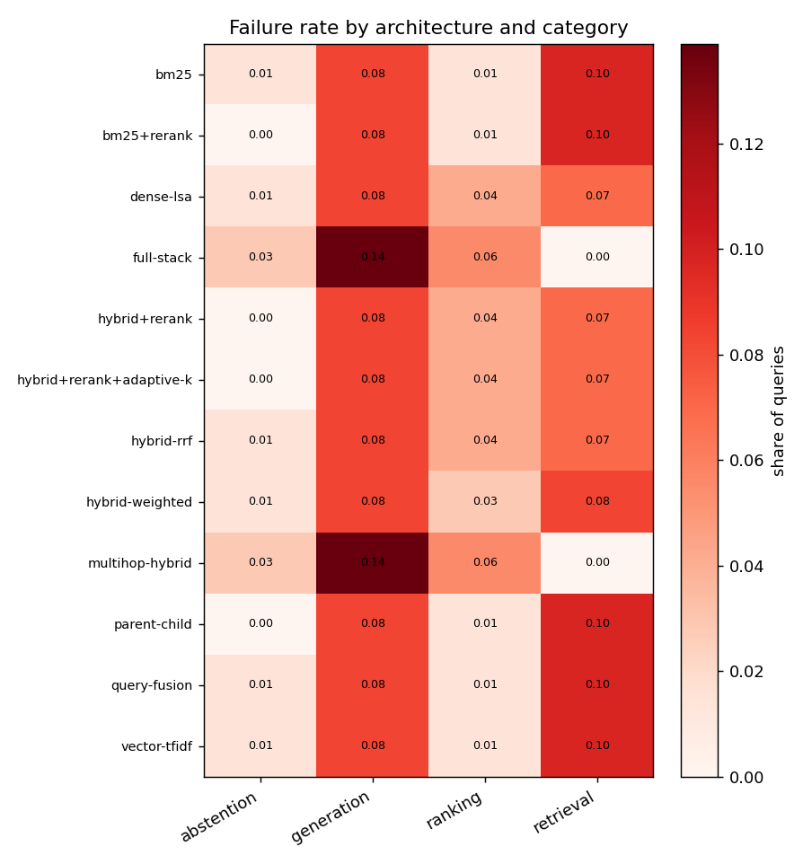

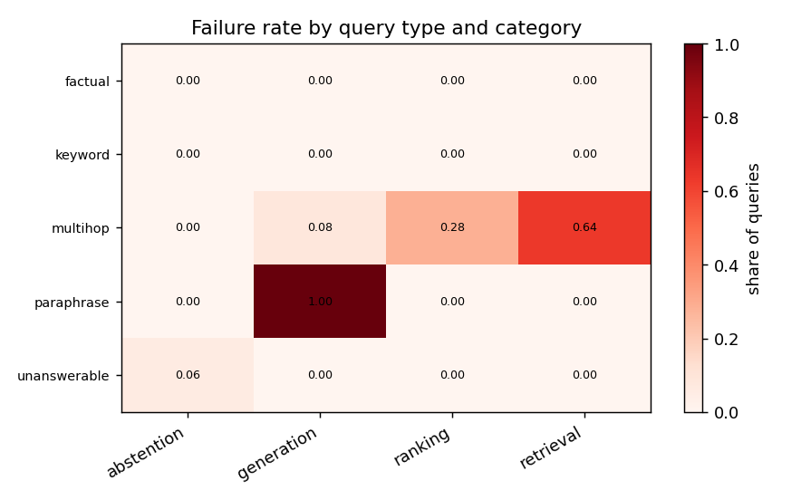

## 5b. Intervention before/after

`bm25` → `hybrid+rerank` on the same queries: fixed **1**, regressed **0**, still failing **14** (accuracy 0.792 → 0.806).

## 6. Query-aware router

Held-out n=72. Learned router f1=0.806 vs best fixed `bm25+rerank` 0.806 (diff +0.000, CI [+0.000, +0.000]); oracle 0.806. Rule router 0.792. A router only 'wins' if the CI excludes zero.

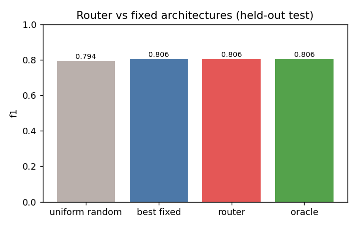

```
constant router → bm25+rerank
```

## 7. Ablation (remove one component at a time)


**Ablated − full, paired**

| metric | ablation | baseline | n_pairs | mean_arch | mean_baseline | delta_vs_full(ablated−full) | ci_lo | ci_hi | p_permutation | p_wilcoxon | cohens_dz | effect | cliffs_delta | p_adj_bh | significant |
|---|---|---|---|---|---|---|---|---|---|---|---|---|---|---|---|
| f1 | −adaptive_k | FULL | 72 | 0.778 | 0.778 | 0.000 | 0.000 | 0.000 | 1.000 | 1.000 | 0.000 | negligible | 0.000 | 1.000 | False |
| f1 | −hybrid (→bm25 only) | FULL | 72 | 0.778 | 0.778 | 0.000 | 0.000 | 0.000 | 1.000 | 1.000 | 0.000 | negligible | 0.000 | 1.000 | False |
| f1 | −multihop | FULL | 72 | 0.806 | 0.778 | 0.028 | 0.000 | 0.069 | 0.508 | 0.157 | 0.168 | negligible | 0.028 | 1.000 | False |
| f1 | −rerank | FULL | 72 | 0.694 | 0.778 | -0.083 | -0.153 | -0.028 | 0.032 | 0.014 | -0.299 | small | -0.083 | 0.128 | False |

## 8. Sweep: chunk_size


**chunk_size**

| chunk_size | overlap | n | f1 | ndcg@10 | recall@10 | mrr | lat_p50_ms | lat_p95_ms | cost_per_query_usd | tokens_per_query |
|---|---|---|---|---|---|---|---|---|---|---|
| 60 | 0 | 168 | 0.560 | 0.864 | 0.888 | 0.925 | 2.024 | 2.828 | 0.000 | 302.321 |
| 60 | 20 | 168 | 0.589 | 0.887 | 0.899 | 0.949 | 2.603 | 5.060 | 0.000 | 323.036 |
| 120 | 0 | 168 | 0.595 | 0.893 | 0.899 | 0.958 | 2.948 | 5.314 | 0.000 | 483.536 |
| 120 | 20 | 168 | 0.595 | 0.893 | 0.899 | 0.958 | 3.357 | 4.847 | 0.000 | 483.536 |
| 200 | 0 | 168 | 0.595 | 0.893 | 0.899 | 0.958 | 2.490 | 3.563 | 0.000 | 483.536 |
| 200 | 20 | 168 | 0.595 | 0.893 | 0.899 | 0.958 | 2.542 | 3.474 | 0.000 | 483.536 |

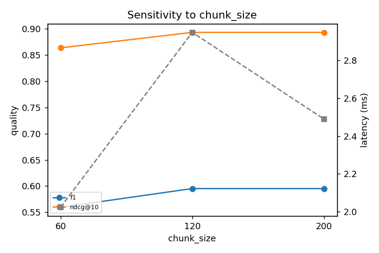

## 8. Sweep: top_k


**top_k**

| k | n | f1 | ndcg@10 | recall@10 | mrr | lat_p50_ms | lat_p95_ms | cost_per_query_usd | tokens_per_query |
|---|---|---|---|---|---|---|---|---|---|
| 1 | 168 | 0.595 | 0.893 | 0.899 | 0.958 | 1.979 | 2.302 | 0.000 | 112.512 |
| 3 | 168 | 0.595 | 0.893 | 0.899 | 0.958 | 1.950 | 2.753 | 0.000 | 302.690 |
| 5 | 168 | 0.595 | 0.893 | 0.899 | 0.958 | 3.079 | 3.456 | 0.000 | 483.536 |
| 8 | 168 | 0.595 | 0.893 | 0.899 | 0.958 | 3.875 | 4.987 | 0.000 | 758.655 |

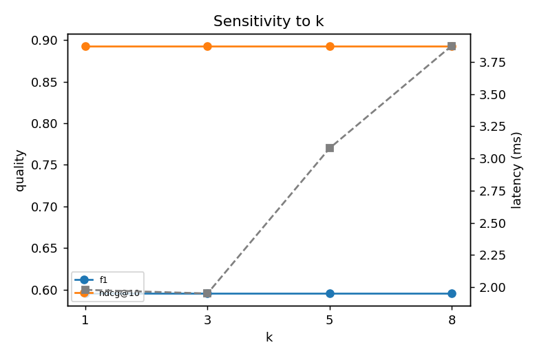

## 8. Sweep: hybrid_weight


**hybrid_weight**

| components | n | f1 | ndcg@10 | recall@10 | mrr | lat_p50_ms | lat_p95_ms | cost_per_query_usd | tokens_per_query |
|---|---|---|---|---|---|---|---|---|---|
| dense=0.00 | 168 | 0.595 | 0.892 | 0.892 | 0.962 | 3.036 | 4.597 | 0.000 | 475.810 |
| dense=0.25 | 168 | 0.595 | 0.890 | 0.899 | 0.951 | 3.149 | 3.593 | 0.000 | 483.274 |
| dense=0.50 | 168 | 0.595 | 0.883 | 0.899 | 0.941 | 2.400 | 3.405 | 0.000 | 491.440 |
| dense=0.75 | 168 | 0.595 | 0.879 | 0.899 | 0.934 | 2.816 | 3.496 | 0.000 | 499.500 |
| dense=1.00 | 168 | 0.595 | 0.863 | 0.902 | 0.906 | 2.396 | 3.383 | 0.000 | 508.756 |

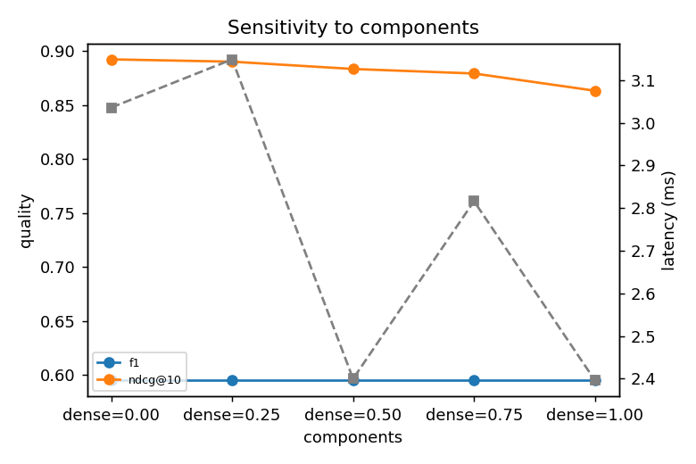

## 8. Sweep: rerank_pool


**rerank_pool**

| rerank_pool | n | f1 | ndcg@10 | recall@10 | mrr | lat_p50_ms | lat_p95_ms | cost_per_query_usd | tokens_per_query |
|---|---|---|---|---|---|---|---|---|---|
| 5 | 168 | 0.607 | 0.885 | 0.899 | 0.956 | 3.506 | 4.388 | 0.000 | 482.101 |
| 10 | 168 | 0.607 | 0.885 | 0.899 | 0.956 | 3.055 | 4.342 | 0.000 | 482.101 |
| 20 | 168 | 0.607 | 0.885 | 0.899 | 0.956 | 2.892 | 4.464 | 0.000 | 482.101 |
| 40 | 168 | 0.607 | 0.885 | 0.899 | 0.956 | 3.752 | 5.349 | 0.000 | 482.101 |

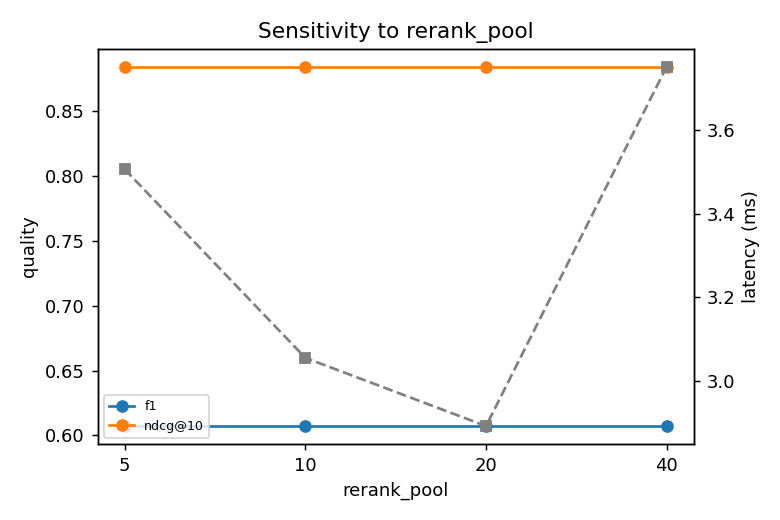

## 9. Confidence calibration

`hybrid+rerank+adaptive-k`: ECE 0.087 → 0.007 after isotonic calibration fitted on validation (Brier 0.072 → 0.012, n=72).

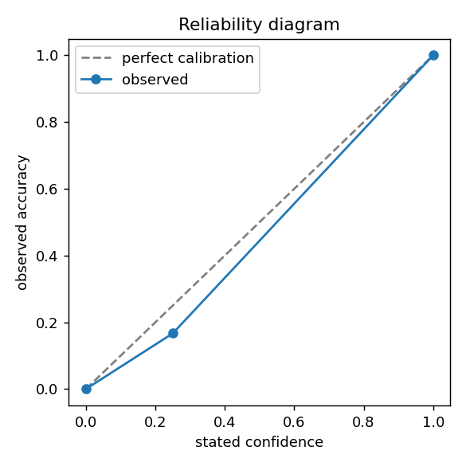

## 10. Caching: none vs exact vs semantic

Semantic hits require matching anchors (entities/numbers/codes), corpus fingerprint and requirements. Latency uses a simulated backend delay. `harmful_hits` = cached answer worse than a fresh one.

**Cache modes**

| mode | hit_rate | mean_latency_ms | p95_latency_ms | f1 | harmful_hits | latency_reduction_pct | storage_bytes | evictions |
|---|---|---|---|---|---|---|---|---|
| none | 0.000 | 43.603 | 44.532 | 0.856 | 0 | 0.000 | 0 | 0 |
| exact | 0.333 | 29.289 | 44.956 | 0.856 | 0 | 32.828 | 15586 | 0 |
| semantic | 0.583 | 18.934 | 46.023 | 0.856 | 0 | 56.576 | 9027 | 0 |

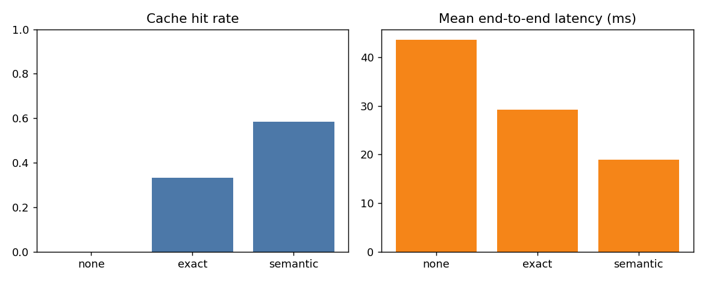

```
{
  "naive_cache(no_invalidation)": {
    "n": 15,
    "stale_answers": 15,
    "stale_answer_rate": 1.0,
    "hits": 15,
    "misses": 15,
    "hit_rate": 0.5,
    "miss_rate": 0.5,
    "evictions": 0,
    "storage_bytes": 2098,
    "mean_lookup_ms": 0.012706200004686252
  },
  "fingerprinted_cache": {
    "n": 15,
    "stale_answers": 0,
    "stale_answer_rate": 0.0,
    "hits": 0,
    "misses": 30,
    "hit_rate": 0.0,
    "miss_rate": 1.0,
    "evictions": 0,
    "storage_bytes": 2098,
    "mean_lookup_ms": 0.012835233322524195
  }
}
```

## 11. Synthetic query validation

60 generated; valid rate 1.00 (95% CI 0.94–1.00); duplicates 0.00%; leakage 0.00%. Real-vs-synthetic ranking agreement: Kendall τ=0.674199862463242, top-1 agrees: False, distorts ranking: True (degenerate ties: False). A stratified sample for human review is in `human_validation_sample.csv`.

```
{
  "n": 60,
  "valid_rate": 1.0,
  "valid_rate_ci95": [
    0.93982814785791,
    0.9999999999999998
  ],
  "check_pass_rates": {
    "source_supports_answer": 1.0,
    "source_is_relevant": 1.0,
    "no_answer_leak": 1.0,
    "not_trivial_copy": 1.0,
    "not_duplicate": 1.0,
    "no_real_overlap": 1.0
  },
  "duplicate_rate": 0.0,
  "leak_rate": 0.0,
  "real_overlap_rate": 0.0,
  "distinct_1": 0.24355300859598855,
  "distinct_2": 0.4913494809688581,
  "type_entropy_bits": 0.0
}
```

## 12. Load test (in-process)


**Concurrency sweep**

| concurrency | requests | errors | throughput_qps | mean_ms | p50_ms | p95_ms | p99_ms |
|---|---|---|---|---|---|---|---|
| 1 | 100 | 0 | 473.945 | 2.080 | 2.053 | 2.262 | 2.679 |
| 2 | 100 | 0 | 476.834 | 4.104 | 4.141 | 8.171 | 10.157 |
| 4 | 100 | 0 | 480.797 | 7.681 | 2.145 | 22.156 | 26.606 |
| 8 | 100 | 0 | 420.848 | 14.994 | 2.817 | 52.679 | 79.468 |

## 13. Prompt-injection defence

Passages containing an injection payload are planted next to each query's evidence.

**Attack success rate**

| prompt_construction | n | hijacked | attack_success_rate |
|---|---|---|---|
| undefended (role tokens only) | 15 | 15 | 1.000 |
| defended (strip + delimit) | 15 | 0 | 0.000 |

## Limitations & honesty notes

- **The dataset is a small synthetic offline fixture. Nothing in this report is a research result.** It verifies that the pipeline works; re-run with `--dataset squad|msmarco|beir:<name>` on real data for findings.
- Architectures are compared on the held-out **test split (n=72)**; train (n=120) trained the router and validation (n=48) calibrated abstention thresholds. Confidence intervals are wide when n is small — treat overlapping CIs as ties.
- Default components are offline stand-ins: TF-IDF/LSA for dense embeddings, a lexical cross-scorer for a cross-encoder, an extractive generator for an LLM, and lexical-support proxies for faithfulness. Swap in real ones via `DenseEncoderRetriever`, `CrossEncoderReranker`, `LLMGenerator` and `LangChainAdapter`, and validate any LLM judge against human labels (Cohen's κ).
- Latency is measured in-process on one machine (shared Python GIL under concurrency); use `load_test.py` against the HTTP API for deployment numbers. Cache latency savings use a **simulated** backend delay and are labelled as such.
- Many comparisons are made; paired tests are Benjamini–Hochberg corrected within each metric, but exploratory findings still need replication.
- Extractive generation is deterministic; for stochastic LLM generators repeat runs and report `run_to_run_variability`.

## Reproducibility record


```
{
  "id": "20261018-110135-e7cf3510",
  "seed": 42,
  "config": {
    "dataset": "fixture",
    "max_queries": 240,
    "seed": 42,
    "chunk_size": 120,
    "overlap": 20,
    "k": 5,
    "baselines": [
      "vector-tfidf",
      "bm25"
    ],
    "latency_budget_ms": 500.0,
    "simulate_backend_ms": 40.0,
    "n_synthetic": 60,
    "load_requests": 100,
    "run_sweeps": true,
    "run_cache": true,
    "run_synthetic": true,
    "run_load": true,
    "out_dir": "outputs/lab"
  },
  "dataset": {
    "name": "offline_fixture",
    "version": "seed7",
    "fingerprint": "b837e5b3773ba9c0",
    "n_passages": 140,
    "n_queries": 240,
    "n_unanswerable": 40,
    "query_types": {
      "factual": 80,
      "keyword": 40,
      "paraphrase": 40,
      "multihop": 40,
      "unanswerable": 40
    },
    "notes": "Synthetic offline fixture for pipeline verification \u2014 NOT a research benchmark."
  },
  "env": {
    "python": "3.12.3",
    "platform": "Linux-6.18.44-fc-v139-x86_64-with-glibc2.39",
    "numpy": "2.4.4",
    "pandas": "3.0.2",
    "scipy": "1.17.1",
    "scikit-learn": "1.8.0",
    "git": {
      "commit": "unknown",
      "dirty": false
    },
    "rag_lab_code_hash": "b2027d6d12d2",
    "cpu_count": 1
  }
}
```
